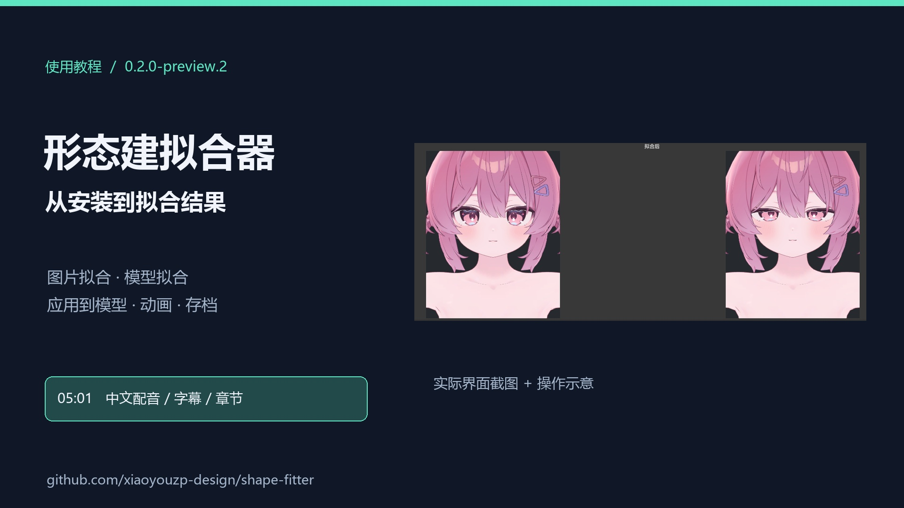

# 形态建拟合器

Unity 编辑器中的脸部形态键拟合工具：根据参考图片或另一个模型调整当前模型，并支持预览、应用、动画导出和拟合存档。

[下载安装包与完整 ZIP](https://github.com/xiaoyouzp-design/shape-fitter/releases/tag/v0.2.0-preview.2)

## 视频教程

约 **5 分 01 秒**，1080p，中文配音与字幕，含 15 个章节。从安装、坐标构建和图片标记，讲到拟合预览、应用、动画与存档。

[观看／下载视频](https://github.com/xiaoyouzp-design/shape-fitter/releases/download/v0.2.0-preview.2/shape-fitter-tutorial-1080p.mp4) · [章节与解说词](教程/说明视频.md) · [字幕](教程/字幕.zh-CN.srt)

采用实际界面截图和操作示意，不是连续现场录屏。

## 安装

已验证环境：Windows / Unity 2022.3.22f1。当前版本：0.2.0-preview.2（预览版）。

1. 在下载页获取 `.unitypackage` 安装包并导入 Unity。离线发行文件名为 `形态建拟合器-0.2.0-preview.2.unitypackage`。
2. 等待编译完成，打开顶部菜单 **形态键拟合**。
3. 选择一个带脸部形态键的模型，按下面的流程开始使用。

插件安装在 `Assets/形态建拟合器`。手工标注和拟合无需 Python；自动标点为可选功能，见 [自动标点安装](Assets/形态建拟合器/Documentation/自动标点安装.zh-CN.md)。

## 开始使用

| 目标 | 操作流程 |
| --- | --- |
| 根据图片调整模型 | 构建模型坐标 → 图片拟合 → 标记或描出图片特征 → 拟合并预览 |
| 让模型接近另一个模型 | 分别构建两个模型的坐标 → 模型拟合 → 预览结果 |
| 使用拟合结果 | 应用到模型、保存为动画，或保存拟合存档 |
| 查看已保存结果 | 打开“拟合存档”查看预览，再应用或导出 |

模型坐标可以自动生成候选，使用前需检查眼、鼻、嘴和脸廓的位置。图片侧可手工点选或描边，也可安装自动标点引擎后生成候选。详见 [使用说明](Assets/形态建拟合器/Documentation/使用说明.zh-CN.md)。

## 文档

- [使用说明](Assets/形态建拟合器/Documentation/使用说明.zh-CN.md)
- [可选自动标点安装](Assets/形态建拟合器/Documentation/自动标点安装.zh-CN.md)
- [版本记录](Assets/形态建拟合器/Documentation/CHANGELOG.zh-CN.md)
- [升级与卸载](Assets/形态建拟合器/Documentation/升级与卸载.zh-CN.md)（已安装用户）
- [审计报告](Assets/形态建拟合器/Documentation/审计报告.zh-CN.md) · [来源与许可](Assets/形态建拟合器/Documentation/来源与许可.zh-CN.md)

本包不含人物模型、参考照片或检测权重。当前是针对指定模型和坐标映射的原型，不能保证任意 VRM 或任意真实照片都能可靠恢复。
